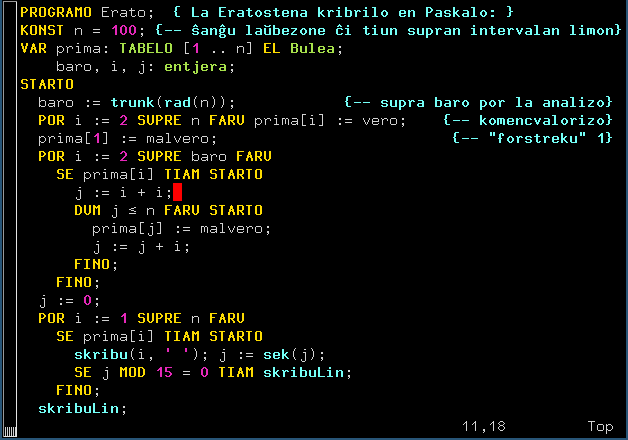

# Paskalo, la esperantigita *Pascal*

> “Paskalo” is a pseudocode based on the Pascal programming language by
 Niklaus Wirth, adapted for use in Esperantic studies of Computer Science.

**Paskalo** estas esperantigita programlingvo *Pascal* uzata en kelkaj
esperantlingvaj verkoj (ekz‑e [Komputada
Leksikono](https://eo.wikipedia.org/wiki/Komputada_Leksikono), esperanta
[Vikipedio](https://eo.wikipedia.org/wiki/Paskalo_(programlingvo)))
kiel [pseŭdokodo](https://eo.wikipedia.org/wiki/Pse%C5%ADdokodo) por
prezenti al lernantoj kaj legantoj bazajn nociojn de programado kaj
krestomatiajn algoritmojn.

Por faciligi legadon de la pseŭdokodaj programoj dezirindas forigi la
lingvan baron — en la okazo de esperanta verko, ebligi la uzon de la
esperanta leksiko. Konkrete tio postulas
 * disponeblon de la literoj de Esperanto, kaj
 * esperantigon de la ŝlosilvortoj kaj antaŭdifinitaj nomoj de la
   funkcioj, konstantoj ktp (kp la franclingvan
   [ekzemplon](https://fr.wikipedia.org/wiki/Pseudo-code#Exemple) en
   la franca Vikipedio).

Ambaŭ postuloj prezentas nenian problemon en la publikaĵoj
(tipografiaj, retaj aŭ bitlibraj) — Unikodaj tiparoj nun ĉie
disponeblas, kaj la tradukoj de la Paskalaj ŝlosilvortoj ekzistas jam
de post 1995 (kiam ilin publikigis la «Komputika leksikono»,
pp. 245‒246; rete [ĉi
tie](https://bertilow.com/div/komputada_leksikono/PRI-PAS.html#Sxlosilvortoj-de-Pascal-kaj-Paskalo)
kaj [en Vikipedio](https://eo.wikipedia.org/wiki/Paskalo_(programlingvo))).
Sed utilus havi komputilan realigon de Paskalo, por fidinde kontroli
la prezentotajn algoritmojn.

Estus troa heroaĵo realigi esperantigitan Paskalan
[tradukilon](https://eo.wikipedia.org/wiki/Tradukilo) (angle
*compiler*), sed estas relative facila afero fari Paskalan
[antaŭtraktilon](https://eo.wikipedia.org/wiki/Anta%C5%ADtraktilo)
(angle *preprocessor*) por jam ekzistanta tradukilo angleca. Kaj tion
mi faris, kiel estas priskribite ĉi-sube. Mi faris tion en kaj por
Linukso (Debiana/Ubunta branĉo); sendube tio fareblas ankaŭ por multaj
aliaj sistemoj, sur kiuj disponeblas *Free Pascal* kaj *Perl*.

## La baza tradukilo
Estkiel bazon mi prenis la «liberan Paskal-tradukilon» FPC (vd ĝian
retejon «[free Pascal](https://www.freepascal.org/)»). Ĝi estas
disponebla por multaj komputilaj arkitekturoj kaj operaciumoj
(Windows, Linux, Mac OS X/iOS/iPhoneSimulator/Darwin, FreeBSD, DOS…);
mi instalis la linuksan `fp-compiler-3.2.2` de la Ubunta deponejo.

FPC scipovas Unikodon interne — en signoĉenoj kaj rultempe (almenaŭ en
Linukso, kaj supozeble en aliaj sistemoj kies operaciumo estas
Unikodo-kapabla), ekz‑e:

```pascal
{10 $} cat -n ehxo.pas
     1  PROGRAM ehxo;
     2  BEGIN
     3     writeLn('Eĥoŝanĝo ĉiuĵaŭde');
     4  END.
{11 $} ifpc ehxo.pas
Eĥoŝanĝo ĉiuĵaŭde
{12 $}
```
(`ifpc` estas «interpreta FPC», angle *interpreter fpc;* ĝi tradukas la
argumentan programon kaj tuj rulas la tradukitan programon.)

Tamen en la *nomoj* de programaj leksemoj (angle *identifiers*) FPC
toleras nur la Askiajn literojn (kaj ankaŭ la ciferojn kaj la substrekon,
kompreneble). Do, la ĉapelitaj literoj estas malpermesitaj en la
nomoj; uzante FPC necesas iksigi la esperantajn vortojn (kiel la
nomon `ehxo` en la linio 1 de la ĵusa ekzemplo). Tio estas malbona.

Tamen bonaĵo estas, ke FPC disponigas antaŭtraktilajn makroojn. Tial
eblas uzi tradukojn:
```pascal
{13 $} cat -n makroehxo.pas
     1  {$MACRO ON}
     2  {$define FINO:=END}
     3  {$define PROGRAMO:=PROGRAM}
     4  {$define skribuLin:=Writeln}
     5  {$define STARTO:=BEGIN}
     6
     7  PROGRAMO makroehxo;
     8  STARTO
     9     skribuLin('Eĥoŝanĝo ĉiuĵaŭde');
    10  FINO.
{14 $} ifpc makroehxo.pas
Eĥoŝanĝo ĉiuĵaŭde
{15 $} 
```
Tio ebligas prezenti plenvalorajn programojn (kiuj traktas
verajn esperantajn tekstojn en Unikodo kun la ĉapelitaj leteroj);
ankaŭ eblas uzi en la programoj la tradukitajn simbolvortojn, tamen
surogate skribitajn. La makroojn eblas kolekti en apartan dosieron
`makrooj.inc`, kaj anstataŭ la linioj 1–5 meti la direktivon
   {$INCLUDE 'makrooj.inc'}
Bedaŭrinde ankaŭ la antaŭtraktilo de FPC ne toleras eksteraskiajn
literojn en la makroaj nomoj.

## La Perla skripto
Tamen la modernaj lingvoj (ekz‑e *Python*) ja permesas uzi Unikodajn
literojn (kaj sekve ankaŭ la literojn esperantajn) en la simbolvortoj
kaj nomoj. Tial mi verkis en Perlo antaŭ-antaŭtraktilan skripton `psk`, kiu
 1. Iksigas la programajn nomojn kaj simbolvortojn *ekster la komentoj
    kaj signoĉenoj*. La komentojn kaj la signoĉenojn `psk` lasas
    senŝanĝaj; tio ebligas i.a. printi la vortojn kiaj `Eĥoŝanĝo ĉiuĵaŭde`.
 2. Tradukas kelkajn pseŭdokodajn simbolojn (ekz‑e ≤ ≠ ≥ ↑) en iliajn
    Askiajn prezentojn (respektive `<=` `<>` `>=` `^`).
 3. En la komencon de la traktata programo ĝi enŝovas la direktivon
    `{$INCLUDE 'makrooj.inc'}`.
 4. Se vokite kun la opcio `-A`, la skripto plenumas nur la askiigon,
    kaj sendas la rezulton en la dukton (angle *pipe*), aŭ registras
    ĝin en la dosiero indikita per la kroma opcio `-o `‹dosiernomo›.
 4. Aliokaze `psk` registras la rezulton en provizora dosiero en
   `/tmp`, kaj vokas tradukilon-intertilon `ifpc`, kiu ĝin
    tradukas kaj rulas la maŝinan programon.

## Ekzemploj
Ni konsideru la pseŭdokodan (Paskalan) programon `eĥo.psk` (mi uzas
la sufikson `.psk` por la programoj PSeŭdoKodaj kaj PaS**K**alaj,
kontraste al la sufikso `.pas` kiun atendas la tradukilo FPC):
```pascal
{16 $} cat -n eĥo.psk
     1  PROGRAMO eĥoŝanĝo;
     2    TIPOJ semajntago = (lu, ma, me, ĵa, ve, sa, di);
     3          rref = ↑reela; {la sago in ↑T estas askiigata per ĉapelo: ^T}
     4    VAR   hodiaŭ : semajntago; aux: Bulea;
     5  STARTO
     6    aux := (1 ≠ 2) AŬ vero;  { tio iĝos: &aux := (1 <> 2) AUX vero }
     7    hodiaŭ := ĵa;
     8    skribuLin('Eĥoŝanĝo ĉiuĵaŭde, hodiaŭ estas ', hodiaŭ);
     9  FINO.
{17 $} psk eĥo.psk 
Eĥoŝanĝo ĉiuĵaŭde, hodiaŭ estas jxa
{18 $}
{18 $} psk -A eĥo.psk | cat -n
     1  {$INCLUDE 'makrooj.inc'} PROGRAMO ehxosxangxo;
     2    TIPOJ semajntago = (lu, ma, me, jxa, ve, sa, di);
     3          rref = ^reela; {la sago in ↑T estas askiigata per ĉapelo: ^T}
     4    VAR   hodiaux : semajntago; &aux: Bulea;
     5  STARTO
     6    &aux := (1 <> 2) AUX vero;  { tio iĝos: &aux := (1 <> 2) AUX vero }
     7    hodiaux := jxa;
     8    skribuLin('Eĥoŝanĝo ĉiuĵaŭde, hodiaŭ estas ', hodiaux);
     9  FINO.
{19 $}
```
Ĉi-supre estas montritaj:
 1. la dosiero `eĥo.psk` sub {16 \$};
 2. la eligaĵo de la komando `psk eĥo.psk` {17 \$}, kiu antaŭtraktas la
    doseron `eĥo.psk` kaj nevideble submetas la antaŭtraktitan programon
    al `ifpc`, kiu ĝin tradukas en maŝinkodon kaj ĝin plenumas;
 3. la antaŭtraktitan programon montras la komando {18 \$}; mi ripetis
    la antaŭtraktadon por demonstri, en kio konsistas la antaŭtraktado
    (la opcio `-A` eligas la antaŭtraktitan programon kaj haltigas la
    laboron).

Do, en la eligaĵo de {18 \$} oni povas vidi, ke la antaŭtraktilo
enskribas la makroojn per la direktivo `$INCLUDE`; iksigas la nomojn
de la programobjektoj ekster la komentoj kaj signoĉenoj (ekz‑e en la
linio 7 `hodiaŭ := ĵa` iĝas `hodiaux := jxa`), sed lasas ĉion senŝanĝa
en la komentoj kaj signoĉenoj (ekz‑e komparu en la linio 8 la aperojn
de `hodiaŭ` kaj `hodiaux`). Simile estas redaktataj aŭ resp. lasitaj
senŝanĝe la simboloj `↑`, `≠`. Normale la uzanto ne bezonas konsulti
la rezulton de antaŭtraktado, kaj tiujn ŝanĝojn ne vidos.

*Pascal* rezervas siajn ŝlosilvortojn (malpermesas uzi ilin kiel
nomojn en la uzulaj programoj); tio sekvigas similan rezervon pri la
ŝlosilvortoj de *Paskalo*. Ĉar la Paskala programo iĝos programo en
*Pascal*, ĝi devas respekti ankaŭ ties malpermesojn, kvankam la uzanto
de Paskalo neniam vidas en sia programo la vortojn `BEGIN, DO, TO` ktp
en la ŝlosilvorta funkcio. Aliflanke, sekve de iksigo iuj ŝlosilvortoj
de Paskalo povas kolizii kun nomo de variablo, kiel en la ĉi-supra
ekzemplo: en `eĥo.psk` la ŝlosilvorto `AŬ` kaj la variablo `aux` estas
malsamaj, sed sekve de iksigo `AŬ` iĝas `AUX` (*Pascal*, kaj sekve
ankaŭ Paskalo, ignoras usklecon en la nomoj). Feliĉe, FPC disponigas
rimedon por solvi la kolizion: oni povas antaŭmeti la kaj-signon, kaj
tiel eviti la kolizion: la antaŭtraktilo ŝanĝas la variablo-nomon al
`&aux` (vd la linion 6 en `eĥo.psk`, sub {16 \$} kaj {18 \$}).
Simile estas solvata la problemo pri la eventualaj nomoj `to`→`&to`,
`do`→`&do`. La uzanto simple ne rimarkos tion.

Pli malbone estas pri la
[enumeracioj](https://bertilow.com/div/komputada_leksikono/E.html#ENUMERACIO)
(kia estas `semajntago` en la ekzemplo). La lingvo ebligas printi
iliajn valorojn (per iliaj nomoj), kaj la nomon `ĵa` el `eĥo.psk` la
tradukilo FPC ricevos en la transskribo `jxa`; tial la maŝino printas
ĝin tiel (`jxa` sub {17 \$}). Eĉ pli malbone, al la Buleaj valoroj
`malvero, vero` respondas en *Pascal* la enumeraciaj valoroj `False,
True`, kaj sekve la ordono `skribuLin(vero)` printos la anglalingvan
`TRUE`.

## La datumtipo *signa*
*Pascal* estas malnova lingvo, unue publikigita en 1970 (proksimume kiel
C), en la epoko kiam la komputilaj signokodoj estis egallonge
unubajtaj (ne pli ol 8-bitaj). Tio grave influis la tekstoprilaborajn
algoritmojn kaj la programlingvojn. En *Pascal* la valoroj de la tipo
`signa` (angle `char`) estas izomorfaj al mallongaj entjeroj de la
intervalo `0..255` (simile al `char` en C); tial la tipo `signa` estas
klasata kiel unu el la *skalaraj tipoj*, al kiu aplikeblas la funkcioj
`pred` kaj `succ` (`ant`aŭanto kaj `sek`vanto), `ord` (`nro`, numero), el kiu
eblas konstrui signoĉenojn, arojn kaj subvariejojn.

Nuntempe la situacio ŝanĝiĝis. Ĉiam pli vaste estas uzata Unikodo,
precipe en sia kodoprezento UTF‑8. Unikodo disponigas skribsignojn de
ĉiuj konataj skribsistemoj, kaj ankaŭ FPC ĝin disponigas, i.a. en la
kodoprezento UTF‑8. Ekz‑e:
```sh
{20 $} cat unikodo.psk 
PROGRAMO unikodo;
STARTO
   skribuLin('Eĥoŝanĝo. С.Б. Покровский. π≈3,14. ☺');
FINO.
{21 $} psk unikodo.psk 
Eĥoŝanĝo. С.Б. Покровский. π≈3,14. ☺
{22 $}
```
Tamen tiu ŝanĝo havas sian prezon. Ĉiuj signoj eksteraskiaj iĝas
plurbajtaj signoĉenoj. Ekz‑e `'c'` efektive estas `signa` valoro unubajta,
al kiu aplikeblas la supre menciitaj funkcioj; sed `'ĉ'` estas
signoĉeno, ĝi ne povas valorizi variablon de la tipo `signa`, estus
eraro demandi pri la signoj antaŭa aŭ posta — t.e. aperoj `ant('ĉ')` aŭ
`sek('ĉ')` kaŭzos erarojn, samkiel la evidente erara `sek('abc')`.

Tekstotraktado ne estas avantaĝa trajto de *Pascal*, ĝi havas nur striktan
minimumon da rimedoj por tio, kvankam ili formas originalan kaj
elegantan sistemon. Al Unikodo en tiu sistemo mankas loko. Feliĉe,
pliparto da krestomatiaj algoritmoj (por kies prezentado Paskalo devas
servi kiel pseŭdokodo) la restanta malmulto ja plene sufiĉas.

Kvankam la nuna tendenco estas transiri al Unikodo, tamen granda parto
de la mondo (precipe la landoj okcidentaj, por kies bezonoj plene
sufiĉas la Latino-1ª, aŭ pli ĝuste CP1252) plu uzas unubajtajn signokodon.
En Esperanto simile povas funkcii la normo Latino-3ª, nun ne plu
uzata, tamen ja plu disponebla kaj subtenata de multaj programaj
produktoj, i.a. de FPC. Per tiu normo eblas prezenti tiun parton de la
koncepto de la programlingvo *Pascal*, kiu malakordas kun Unikodo.

## Latino-3ª en Unikoda medio
Defaŭlte la linuksa versio de FPC funkcias en UTF-8. Tamen ĝi povas
funkcii ankaŭ en la Latina-3ª, se ordonita per la direktivo  
`USES cp8859_3;`
— kiu en Paskalo akceptas la formon  
`UZAS cp8859_3;`

La linuksaj terminaloj nun funkcias en UTF-8, tamen disponeblas la
programo `luit`, kiu funkcias kiel ambaŭdirekta *filtrilo* inter la
Unikoda terminalo kaj ĝia ida procezo — en nia okazo, FPC-procezo:
 * de la terminalo `luit` ricevas enigaĵojn en UTF-8, kaj transkodas
   ilin en Latinon-3an;
 * de la ida FPC-procezo `luit` ricevas eligaĵojn en la Latino-3ª,
   kiujn ĝi transkodas al UTF-8.

Ĉi tiun funkciadon la antaŭtraktilo `psk` penumas aŭtomate, se ĝi ricevas la
opcion `-3`. Kun tiu opcio, ĝi
 * transkodas *la tutan* fontan programon en la Latinan-3an (do, ankaŭ
   signoĉenojn kaj la komentojn). Signojn kiuj mankas en la Latino-3ª
   (ekz‑e `π`) ĝi anstataŭigas per `?`. Tamen la pseŭdokodajn
   simbolojn (kiaj `≠ ≤ ↑`) ĝi askiigas (per resp. `<> <= ^`);
 * la programajn nomojn kaj vortosimbolojn ĝi iksigas (ĉar FPC ne
   komprenas nomojn kun signoj eksteraskiaj);
 * enskribas la direktivon `UZAS cp8859_3;`
 * registras la antaŭtraktitan tekston en `/tmp`, krom se alia celnomo
   estis preskribita per la opcio `-o`;
 * vokas FPC kun la luit-filtrilo kaj la ĵus registrita antaŭtraktita programo.

Ekz‑e la sekva programo printas la eksteraskiajn signojn de la
Latino-3ª en tabela formo:
```pascal
{23 $} cat -n  signaro.psk
     1  PROGRAMO Signaro; {Eligu la signojn Sgn($80) .. Sgn($FF) de la Latina-3ª}
     2  KONST unua = 160; lasta = 255;  {aŭ la samo 16-ume: 160 = $A0, 255 = $FF}
     3  TIPO signonumeroj = unua .. lasta;
     4  VAR s: Entjera;
     5      nedifinitaj: ARO EL signonumeroj; {la vakaj pozicioj de Latino-3ª}
     6  STARTO
     7    SkribuLin('=== Eĥoŝanĝo ĉiuĵaŭde en Latino-3ª ===');
     8    nedifinitaj := [$A5, $AE, $BE, $C3, $D0, $E3, $F0];
     9    POR s := unua SUPRE lasta FARU STARTO
    10      Skribu(' ');    
    11      SE s EN nedifinitaj TIAM Skribu('#')
    12      ALIE Skribu(Sgn(s));
    13      SE s MOD 16 = 15 TIAM SkribuLin;
    14    FINO;
    15  FINO.
{24 $} psk -3 signaro.psk
=== Eĥoŝanĝo ĉiuĵaŭde en Latino-3? ===
   Ħ ˘ £ ¤ # Ĥ § ¨ İ Ş Ğ Ĵ   # Ż
 ° ħ ² ³ ´ µ ĥ · ¸ ı ş ğ ĵ ½ # ż
 À Á Â # Ä Ċ Ĉ Ç È É Ê Ë Ì Í Î Ï
 # Ñ Ò Ó Ô Ġ Ö × Ĝ Ù Ú Û Ü Ŭ Ŝ ß
 à á â # ä ċ ĉ ç è é ê ë ì í î ï
 # ñ ò ó ô ġ ö ÷ ĝ ù ú û ü ŭ ŝ ˙
{25 $}
```
Ĉi tiu ekzemplo pruvas, ke ĉiuj ĉapelitaj literoj estas ĝuste
eligataj, kaj ke iliaj signonumeroj estas unubajtaj (malpli grandaj ol
256). Aliflanke, la signo `ª` (en «Latino-3ª» fine de la linio 7), kiu
mankas en la signaro de la Latino-3ª (ĝian lokon laŭ Unikodo kaj laŭ
Latino‑1ª en la Latino‑3ª okupas la turka `Ğ`), anstataŭas la
demadosigno `?`.

Normale la uzanto ne bezonas vidi la transkoditan programon, sed la
scivoluloj povas fari tion aldoninte la opcion `-o`, aŭ eligante la
ĝin el `/tmp` (ŝanĝoj okazis nur en la linioj 1–7):
```pascal
{26 $} cat -n /tmp/l3-signaro.pas | iconv -f ISO8859-3 | head -7   
     1  {$INCLUDE 'makrooj.inc'} PROGRAMO Signaro; UZAS cp8859_3; {Eligu la signojn Sgn($80) .. Sgn($FF) de la Latina-3?}
     2  KONST unua = 160; lasta = 255;  {aŭ la samo 16-ume: 160 = $A0, 255 = $FF}
     3  TIPO signonumeroj = unua .. lasta;
     4  VAR s: Entjera;
     5      nedifinitaj: ARO EL signonumeroj; {la vakaj pozicioj de Latino-3?}
     6  STARTO
     7    SkribuLin('=== Eĥoŝanĝo ĉiuĵaŭde en Latino-3? ===');
```
La komando `iconv -f ISO8859-3` transkodas el la Latino‑3ª en la
terminalan kodoprezenton (ĉi-okaze, al UTF‑8). Sen ĝi la eligaĵo estus
malbone legebla:
```pascal
{27 $} cat -n /tmp/l3-signaro.pas | head -7   
     1  {$INCLUDE 'makrooj.inc'} PROGRAMO Signaro; UZAS cp8859_3; {Eligu la signojn Sgn($80) .. Sgn($FF) de la Latina-3?}
     2  KONST unua = 160; lasta = 255;  {a� la samo 16-ume: 160 = $A0, 255 = $FF}
     3  TIPO signonumeroj = unua .. lasta;
     4  VAR s: Entjera;
     5      nedifinitaj: ARO EL signonumeroj; {la vakaj pozicioj de Latino-3?}
     6  STARTO
     7    SkribuLin('=== E�o�an�o �iu�a�de en Latino-3? ===');
```
En la linio 1 ni vidas la aldonaĵojn «`{$INCLUDE 'makrooj.inc'}`» kaj
«`UZAS cp8859_3;`». La linio rezultas longa, sed la numerado de la
linioj (necĉesa por kompreni la eventualaljn mesaĝojn de IPC) restas senŝanĝa.

La sekva ekzemplo ilustras dialogon kun la programo: la uznto enigas
signon el la signaro de la Latino‑3ª, kaj la pogramo responde eligas
la sekvan signon (laŭ la signkodo Latino‑3ª, se tia signo ekzistas kaj
estas difinita):
```pascal
{28 $} cat -n sekva_signo.psk
     1  PROGRAMO sekva_signo;
     2    VAR s: Signa;
     3  STARTO
     4    RIPETU
     5      Skribu('Tajpu signon: '); LeguLin(s);
     6      SkribuLin('La sekva signo estas: ', Sek(s));
     7    ĜIS s = '.';
     8    SkribuLin('Ĝis revido!');
     9  FINO.
{29 $} psk -3 sekva_signo.psk
Tajpu signon: X
La sekva signo estas: Y
Tajpu signon: ĉ
La sekva signo estas: ç
Tajpu signon: ŭ
La sekva signo estas: ŝ
Tajpu signon: .
La sekva signo estas: /
Ĝis revido!
{30 $}
```
## Instalo
Necesas FPC. Ĝi disponeblas en la Linuksaj deponejoj (almenaŭ en la
Debinaj). Uzu vian pakaĵ-administrilon aŭ ŝelon, ekz‑e
```sh
sudo apt-get install fp-compiler fp-utils
```
Necesas Perlo de la versio ne pli frua ol 5.10 (mi uzis v5.34).  

La regula maniero elŝuti la antaŭtraktilan projekton estas kloni ĝin
el Github:
```sh
git clone https://github.com/pok49/Paskalo
```
Se vi malvolas elŝuti la tutan Git-projekton, elŝutu ien la dosierojn
`traktiloj/psk` kaj `traktiloj/makrooj.ink`, ekz‑e tiel:
```sh
 wget https://raw.githubusercontent.com/pok49/Paskalo/main/traktiloj/{makrooj.inc,psk}
```
Certigu ke `psk` estas plenumebla:
```sh
chmod a+x psk
```
Se vi volas simple provi kaj iom ludi kun la antaŭtraktilo, vi povas
teni ĉion (la dosierojn `makrooj.inc`, la Perlan skripton `psk` kaj viajn
testajn pseŭdokodajn programojn) kune unu en sola eksperimenta dosierujo.

Se vi volas havi pli korektan aranĝon (kaj voki `psk` el ajna via
dosierujo), vi povas meti `psk` en iu ajn dosierujo listigita en via
`$PATH` — vidu
```sh
echo $PATH
```
Ĉe la tradicia Linuksa aranĝo vi havos tie, inter aliaj, `~/.local/bin`,
kiu estas konvena loko. En la saman `~/.local/`-hierarkion konvenas meti
la makroojn:
```sh
mkdir ~/.local/share/psk/
mv makrooj.inc ~/.local/share/psk/
```
Ĝuste tiun lokon la skripto `psk` aldonas al la inkluda serĉvojo ĉe la
voko de `ifpc` —  
`$inc_dir = "$ENV{HOME}/.local/share/psk/"`

## Paskala dosiertipo en `vim`
Se vi uzas la tradicia Linuksan redaktilon `vim` kaj volas diskolorigi
la programojn kun la sufikso `.psk`, elŝutu la dosirojn el la
dosierujo `vim/` de ĉi tiu distribuaĵo.



En la ĉi-suba teksto mi supozas ke en via komputilo viaj vim-agordoj
estas konservataj en la dosierujo `.vim/` (kutime, `~/.vim/`).
 * Metu la dosieron `paskalo.vim` en la dosierujon `.vim/sintax/`
 * Metu la dosieron `psk` en la dosierujon `.vim/ftdetect`

Krome, se vi volas ke inter la signokodoj rekonataj de vim estu la
Latino-3ª, aldonu en la dosieron `.vim/vimrc` proksimume tiajn
liniojn:
```vim
set encoding=utf-8
set fileencodings=ucs-bom,utf-8,iso-8859-3,cp1251
```
(adaptu ilin laŭ via uzmaniero).

## Referencoj
 * [free pascal site](https://www.freepascal.org/)

<!--  LocalWords:  Pascal FPC FPC-procezo luit
 -->
